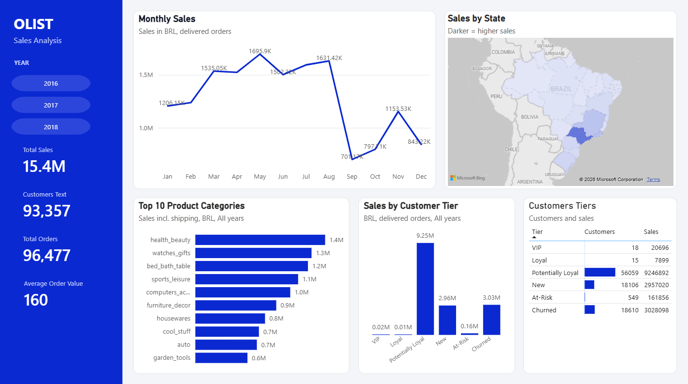

# Olist E-commerce Sales Analysis

Clean Brazilian e-commerce data with **Python**, segment customers with **RFM**, build reporting views in **SQL Server**, and present the results in a **Power BI** dashboard.



## Business questions

1. How do sales change month by month?
2. Which product categories sell the most?
3. Which states drive sales?
4. Which customer groups matter most, and which are at risk of leaving?

## Key results

- **R$15.4M** in sales from **93,357** customers and **96,477** delivered orders (average order value about R$160).
- **"Potentially Loyal" customers are 60% of customers and bring 60% of sales.** They are the group to nurture.
- **97% of customers bought only once.** Getting them to come back is the biggest chance to grow.
- **Sao Paulo, Rio de Janeiro and Minas Gerais** generate 62.5% of sales.
- **November 2017** was the best month (R$1.15M), about 1.5 times October.

| Tier | Customers | Sales (R$) |
|---|---:|---:|
| VIP | 18 | 20,696 |
| Loyal | 15 | 7,899 |
| Potentially Loyal | 56,059 | 9,246,892 |
| New | 18,106 | 2,957,020 |
| At-Risk | 549 | 161,856 |
| Churned | 18,610 | 3,028,098 |

## Method

**Cleaning (Python).** Fix column typos, translate product categories and state names, drop the 1 order with no payment, keep **delivered orders only** (97% of orders), and re-key orders to `customer_unique_id` (the real customer, not the per-order `customer_id`).

**RFM scoring.** Each customer gets a score of 1 to 5 on three measures:

| Measure | Meaning | Scoring |
|---|---|---|
| Recency | Days since last purchase | 5 equal groups (quintiles); fewer days = higher score |
| Frequency | Number of orders | 1 to 4 as they are; 5 or more = 5 |
| Monetary | Total paid (BRL) | Under 20 = 1, 50 = 2, 100 = 3, 500 = 4, otherwise 5 |

The three scores are combined into a code (such as `455`) and mapped to a tier, checked in this order: **VIP** (455, 545, 554, 555), **Loyal** (R >= 4 and F >= 4), **New** (R = 5, F = 1), **Churned** (R = 1, F <= 2), **At-Risk** (R = 2, F = 2 or 3), otherwise **Potentially Loyal**.

**SQL Server views.** `vw_rfm` holds the scores and tiers. `vw_sales_by_tier`, `vw_sales_monthly`, `vw_sales_by_category` and `vw_sales_by_state` each feed one chart in the dashboard.

## Repository structure

```
├── Python/
│   ├── data_cleaning.py     # 1. clean the raw data
│   ├── rfm_analysis.py      # 2. score customers and assign tiers
│   └── load_to_sql.py       # 3. load cleaned tables into SQL Server
├── SQL/
│   ├── rfm.sql              # view: vw_rfm
│   └── view_charts.sql      # views for the dashboard
├── Dashboard/               # Power BI file
├── Data/                    # Raw / Cleaned_data / RFM (raw files not included)
└── images/dashboard.png
```

## How to run

Requirements: Python 3, SQL Server, Power BI Desktop, ODBC Driver 18 for SQL Server.

```bash
pip install pandas openpyxl sqlalchemy pyodbc
```

1. Download the [Olist dataset](https://www.kaggle.com/datasets/olistbr/brazilian-ecommerce) from Kaggle and put the Excel files in `Data/Raw/`.
2. Run `python Python/data_cleaning.py`, then `python Python/rfm_analysis.py`.
3. Create an empty database named `olist` in SQL Server.
4. In `Python/load_to_sql.py`, change `SERVER` to your own server name, then run it.
5. In SSMS, run `SQL/rfm.sql`, then `SQL/view_charts.sql`.
6. Open the Power BI file and refresh the data.

## Contact

Heejeong | [LinkedIn](https://www.linkedin.com/in/joyheejeong/?isSelfProfile=true) | [GitHub](https://github.com/Heejoy)
